<div align="center">

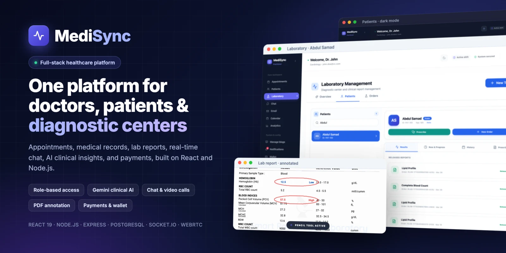

# MediSync

**A full-stack healthcare management platform connecting doctors, patients, and diagnostic centers.**

Appointments · Medical records · Lab reports · Real-time chat & video calls · AI clinical assistant · Billing & payments

[](https://github.com/shahriarkabir280/MediSync/actions/workflows/ci.yml)
[](LICENSE)


</div>

---

## Product demo

<p align="center">
  
</p>

## Screenshots

<table>
  <tr>
    <td width="50%">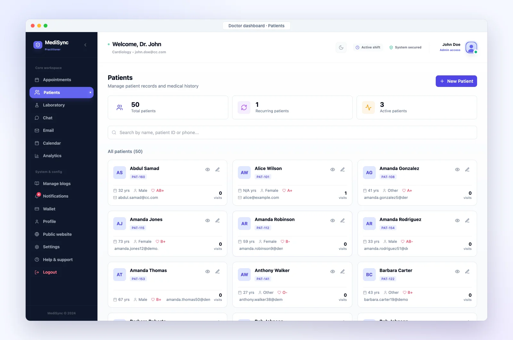<p align="center"><b>Doctor dashboard</b><br/>Patient records, visits and quick actions</p></td>
    <td width="50%">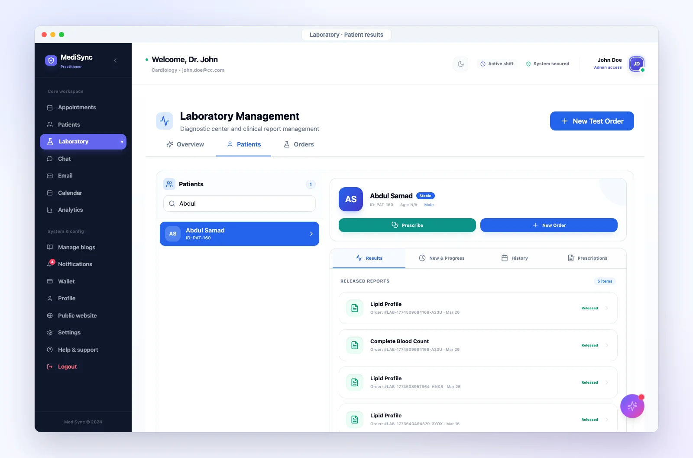<p align="center"><b>Lab workflow</b><br/>Orders, progress tracking and released reports</p></td>
  </tr>
  <tr>
    <td width="50%">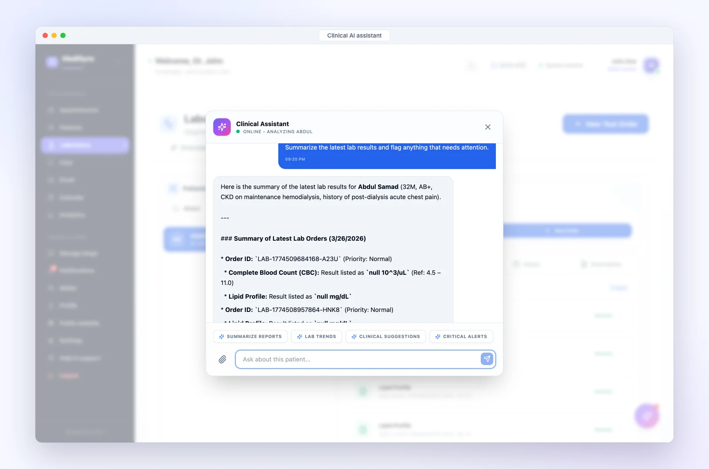<p align="center"><b>Clinical AI assistant</b><br/>Gemini summaries grounded in the patient's lab history</p></td>
    <td width="50%">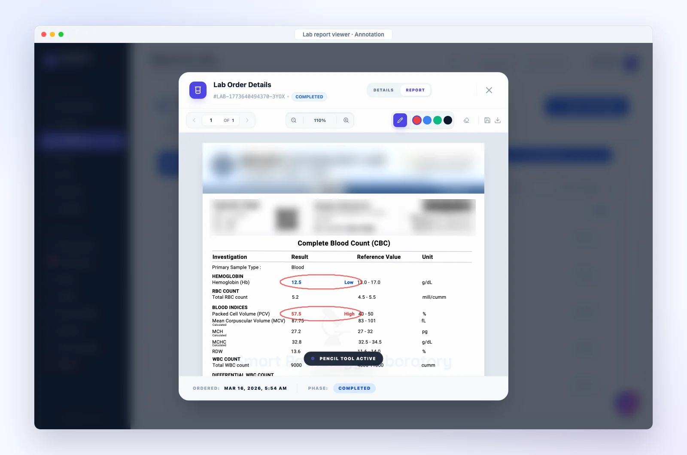<p align="center"><b>Report annotation</b><br/>Mark up PDF reports and save them to the record</p></td>
  </tr>
  <tr>
    <td width="50%">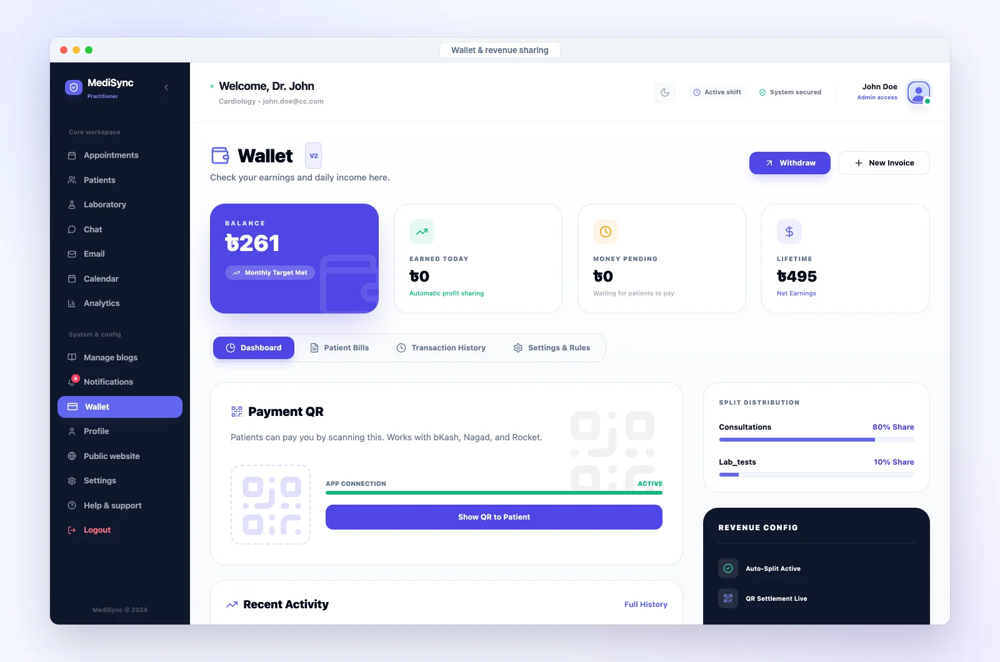<p align="center"><b>Payments &amp; wallet</b><br/>SSLCommerz checkout and automatic revenue sharing</p></td>
    <td width="50%">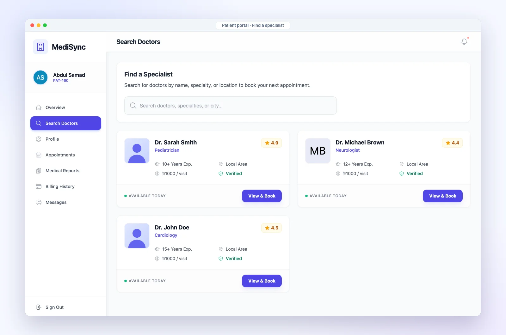<p align="center"><b>Patient portal</b><br/>Find specialists, book visits, view own reports</p></td>
  </tr>
  <tr>
    <td width="50%">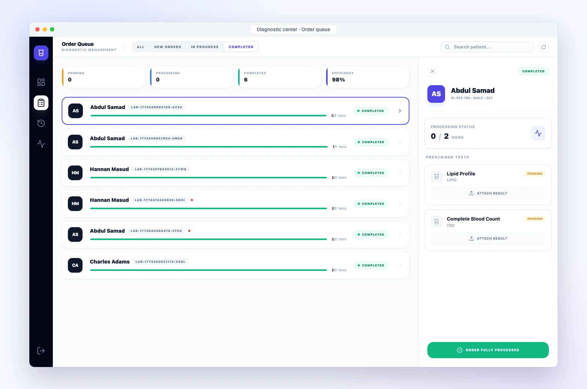<p align="center"><b>Diagnostic center</b><br/>Process lab orders and upload results</p></td>
    <td width="50%">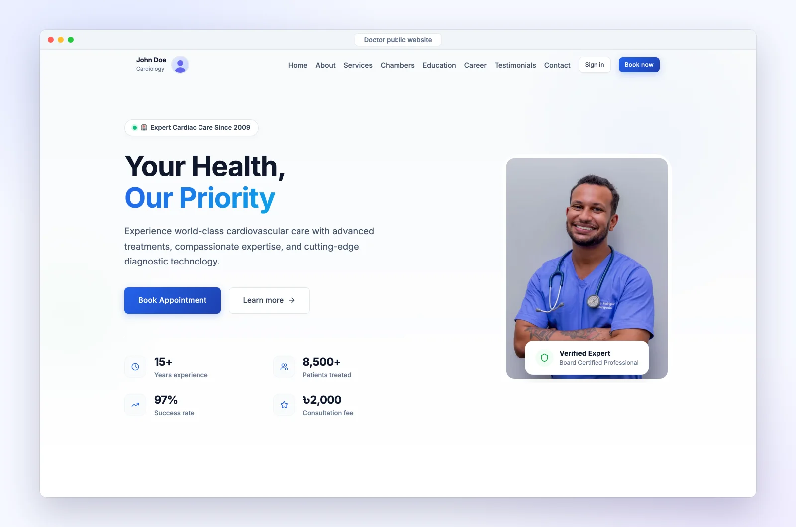<p align="center"><b>Doctor websites</b><br/>Public profile, blog and online booking</p></td>
  </tr>
</table>

<p align="center">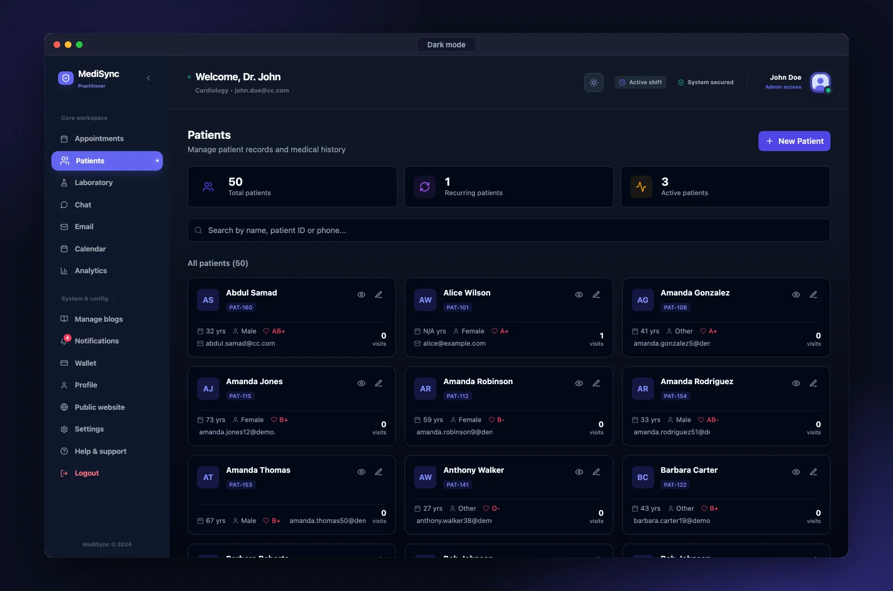<br/><sub>Light and dark themes across every portal</sub></p>

> Screens show demo data. Third-party branding on the sample lab report is blurred.

## Overview

MediSync is a multi-portal clinic platform built on a single Node.js/Express API and a React frontend. Doctors run their practice from one dashboard, patients book and track care from theirs, and diagnostic centers handle lab orders and reports. All three share one PostgreSQL database and a real-time messaging layer.

| Portal | What it does |
|---|---|
| **Doctor dashboard** | Appointments and calendar, patient records, prescriptions, lab orders with PDF report annotation, billing, wallet and payouts, analytics, internal email, chat and video calls, and a personal public website and blog. |
| **Patient portal** | Doctor search and appointment booking, medical history and reports, bills paid online, and chat with their doctors. |
| **Diagnostic center** | Lab order intake and per-test report uploads delivered back to the ordering doctor. |
| **Public website** | Each doctor's public profile (education, experience, services, chambers, testimonials) and blog. |

## Highlights

- **Real-time communication:** a Socket.IO server handles one-to-one and group chat with typing indicators, read receipts, reactions, presence, file and voice-note attachments, plus WebRTC signalling for in-browser video calls.
- **AI clinical assistant:** a Google Gemini assistant answers the doctor's questions using the patient's actual lab history, flagging abnormal and critical values and comparing trends across reports.
- **Lab workflow end to end:** doctor orders, diagnostic-center report uploads, a PDF report viewer with pencil/eraser annotation saved back to the record, and generated prescription PDFs.
- **Payments and revenue sharing:** SSLCommerz checkout (with a built-in mock gateway for development), per-service revenue-split rules between doctor, clinic and referrer, wallet balances, and withdrawal requests.
- **Role-based access control:** one JWT middleware enforces doctor, patient, and diagnostic-center roles with per-record ownership checks across the REST API, the Socket.IO server, and private file downloads.
- **Scale of the build:** about 200 REST endpoints across 19 route modules, a 46-table PostgreSQL schema, and roughly 40k lines of application code.

## Architecture

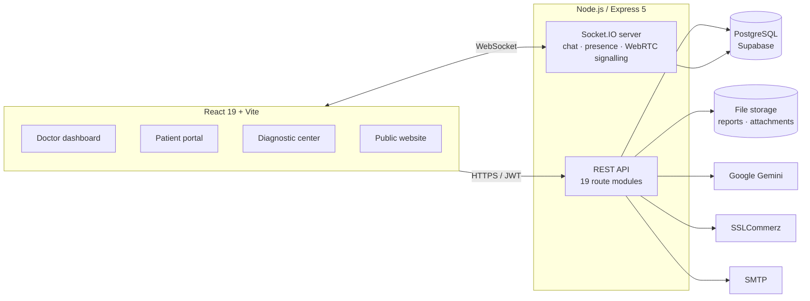

## Tech stack

| Layer | Technologies |
|---|---|
| Frontend | React 19, Vite 6, React Router 7, Tailwind CSS, Radix UI, Zustand |
| Backend | Node.js, Express 5, Socket.IO, Multer, Nodemailer |
| Database | PostgreSQL on Supabase (`@supabase/supabase-js`, `pg`) |
| Auth and security | JWT with role-based access control, bcrypt password hashing, Helmet, CORS allow-list |
| Integrations | Google Gemini (`gemini-3.8-flash`), SSLCommerz, SMTP |
| Documents | `react-pdf`, `pdf-lib`, `jspdf`, `html2canvas` |
| Tooling | ESLint, GitHub Actions CI, Railway (Nixpacks) deployment |

## Getting started

### Prerequisites

- Node.js 20 or later
- A PostgreSQL database; a free [Supabase](https://supabase.com/) project works
- Optional: Gemini API key, SMTP credentials, SSLCommerz sandbox store

### 1. Clone and install

```bash
git clone https://github.com/shahriarkabir280/MediSync.git
cd MediSync
npm install                      # backend
npm --prefix frontend install    # frontend
```

### 2. Configure environment

```bash
cp backend/.env.example backend/.env
```

Fill in at least `JWT_SECRET`, `SUPABASE_URL`, `SUPABASE_KEY` and `DATABASE_URL`. The server checks these at startup and refuses to run without them. Optional integrations switch off cleanly when their keys are missing, and payments fall back to a mock checkout. See [`backend/.env.example`](backend/.env.example) for every variable.

Set `DIAGNOSTIC_EMAIL` and `DIAGNOSTIC_PASSWORD` to enable the diagnostic center login.

### 3. Set up the database

```bash
npm run init-db   # applies backend/schema.sql (idempotent)
npm run seed      # optional sample data
```

### 4. Run

```bash
npm run dev                      # API on http://localhost:3001
npm --prefix frontend run dev    # app on http://localhost:5173
```

## Scripts

| Command | Description |
|---|---|
| `npm run dev` / `npm start` | Start the API server (with or without auto-reload) |
| `npm run init-db` | Apply the database schema |
| `npm run seed` | Load sample data |
| `npm run check` | Syntax-check all backend modules |
| `npm --prefix frontend run lint` | Lint the frontend |
| `npm --prefix frontend run build` | Production build of the frontend |

## Project structure

```
MediSync/
├── backend/
│   ├── server.js          Express app, middleware, route mounting
│   ├── config/            Environment validation, database clients
│   ├── routes/            REST routers, one per domain
│   ├── controllers/       Business logic
│   ├── lib/               Socket.IO server, ID generator, rate limiting
│   ├── schema.sql         PostgreSQL schema
│   └── scripts/           DB init, migrations, maintenance
├── frontend/
│   └── src/
│       ├── pages/         Doctor, patient, diagnostic-center and public pages
│       ├── components/    Shared UI (video call, file messages, forms)
│       ├── hooks/         WebSocket, chat and data hooks
│       └── lib/           API clients, caching, PDF and print utilities
├── docs/                  Design and API documentation
└── .github/workflows/     CI
```

## Documentation

| Topic | Document |
|---|---|
| REST API reference | [docs/api-reference.md](docs/api-reference.md) |
| Manual API testing | [docs/testing-guide.md](docs/testing-guide.md) |
| Chat system and WebSocket events | [docs/chat-system.md](docs/chat-system.md), [docs/chat-privacy.md](docs/chat-privacy.md) |
| Email system | [docs/email-system.md](docs/email-system.md) |
| Notifications | [docs/notification-system.md](docs/notification-system.md) |
| File uploads | [docs/file-uploads.md](docs/file-uploads.md) |
| Unique ID scheme | [docs/unique-ids.md](docs/unique-ids.md) |
| Doctor settings | [docs/settings.md](docs/settings.md) |

## Security model

| Role | Signs in at | Can access |
|---|---|---|
| Doctor | `/` | Their own dashboard data. Routes that name a `:doctorId` must match the signed-in doctor. |
| Patient | `/patient-login` | Only their own profile, medical history, appointments, and report files |
| Diagnostic center | `/diagnostic-login` | Lab order intake and report upload endpoints only |
| Anyone | none | Public doctor websites and blogs, appointment booking, patient signup, payment gateway callbacks |

- Every protected route goes through [`backend/middleware/auth.js`](backend/middleware/auth.js). Chat additionally rejects requests that claim another user's identity.
- Socket.IO connections must present a doctor token. Each event's sender identity is taken from the token, and joining a chat requires being a participant.
- Medical records, chat files, and email attachments under `/uploads` require a signed-in user. Only profile and blog images are public.
- The server refuses to start without `JWT_SECRET`, and tokens passed in file URLs are redacted from request logs.

## Roadmap

- [ ] Per-patient access control between doctors and their own patients (any signed-in doctor can currently view any patient)
- [ ] Re-enable Arcjet rate limiting in production
- [ ] Automated API and component tests in CI
- [ ] Code-split the doctor dashboard bundle
- [ ] Move file uploads to object storage (Supabase Storage / S3)

## Author

**Md. Shahriar Kabir**: [GitHub](https://github.com/shahriarkabir280)
<!-- Add: · [LinkedIn](https://www.linkedin.com/in/your-handle) -->

## License

Released under the [MIT License](LICENSE).
